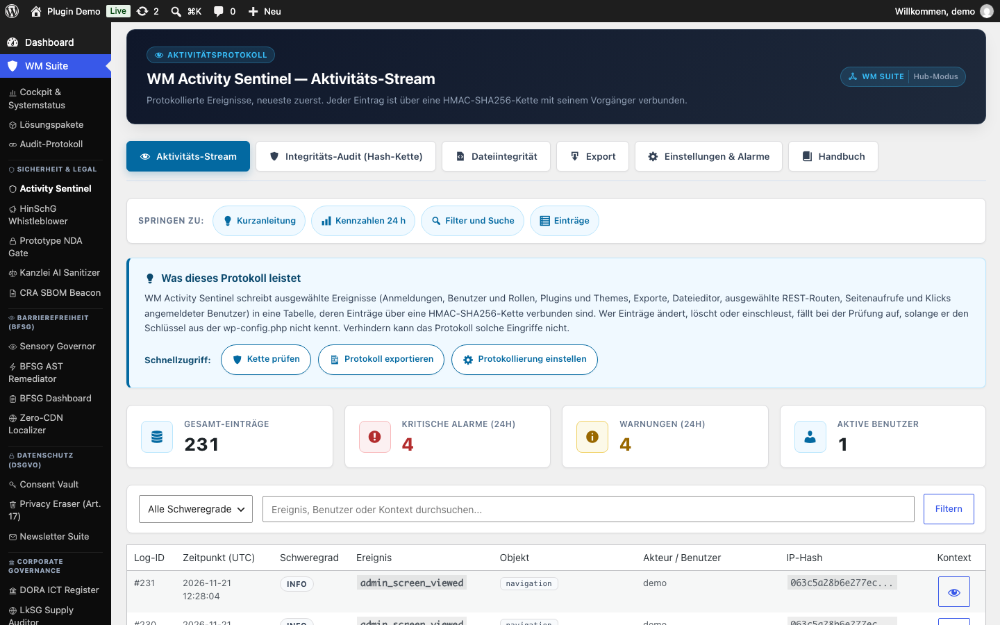
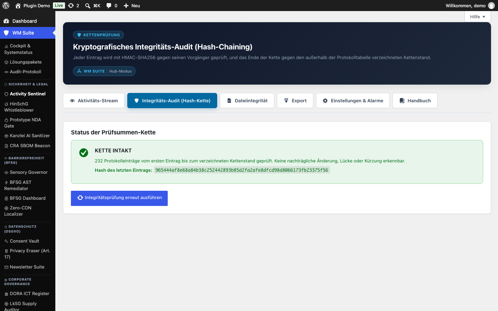
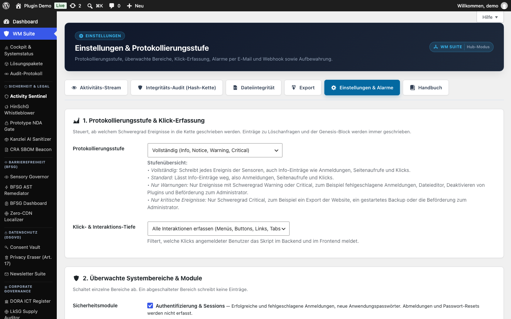
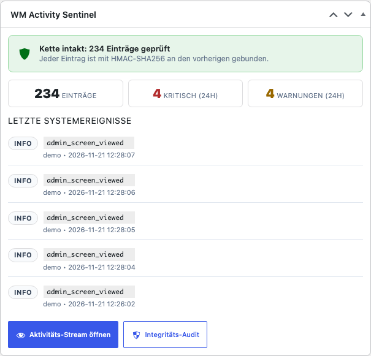

# WM Activity Sentinel (Deutsche Dokumentation)

<p align="center">
  <a href="README.md"></a>
  <a href="README.de.md"></a>
  <a href="README.es.md"></a>
</p>

> **Ein Aktivitätsprotokoll für WordPress, dessen Einträge über eine HMAC-SHA256-Kette verbunden sind: Anmeldungen, Benutzer und Rollen, Plugins und Themes, Exporte und Dateieditor, ausgewählte REST-Routen, Seitenaufrufe und Klicks angemeldeter Benutzer, mit Kettenprüfung, Mail- und Webhook-Alarmen und CSV- oder JSON-Export — es macht nachträgliche Änderungen, Löschungen und Kürzungen für jeden ohne den Schlüssel aus der wp-config.php erkennbar, verhindert sie nicht und bewertet nichts rechtlich**  
> **Plugin-Seite:** [https://arnoldwender.com/wordpress-plugins/wm-activity-sentinel/](https://arnoldwender.com/wordpress-plugins/wm-activity-sentinel/)  
> **Mit einem agentischen Workflow entwickelt:** entstanden mit KI-Coding-Agenten. Prüfen und testen Sie es wie jeden fremden Code, bevor Sie es produktiv einsetzen.  
> **Support & Haftung:** Kein Support (Zero Support) — reproduzierbare Bugs ausschließlich über [GitHub Issues](https://github.com/arnoldwender/wm-wp-activity-sentinel/issues) · kein privater Support · OHNE GEWÄHR („AS IS“) / keine Haftung ([SUPPORT.md](SUPPORT.md))

> Diese Datei beschreibt, was das Plugin tatsächlich ausliefert (v1.4.3; gemessen: WP-CLI kennt `wp sentinel audit|list|fim|demodaten|retention`, REST kennt `POST /telemetry` unter `wm-sentinel/v1`, die Tabellen heißen `wp_wm_activity_logs` und `wp_wm_activity_alerts`, und für Erweiterungen stehen `wm_sentinel_ready`, `wm_sentinel_monitored_options`, `wm_sentinel_public_metrics`, `wm_activity_sentinel_log_event`, `wm_sentinel_security_incident`, die Block-Bindings-Quelle `wm-sentinel/metrics` sowie das GenerateBlocks-Dynamic-Tag `wm_sentinel_metric` bereit; es gibt keinen Shortcode und keinen PDF-Export). Frühere Fassungen vor dem 2026-09-15 nannten nicht implementierte Shortcodes, zusätzliche CLI-Unterbefehle und REST-Endpunkte, abweichende Tabellennamen, PDF-Berichte und unbewiesene Rechtsbewertungen zu GoBD, GeschGehG § 2, DSGVO Art. 32 und CRA, die in diesem Repository nicht existieren. Die Historie der Korrekturen steht in [CHANGELOG.md](CHANGELOG.md).

---

## Screenshots

!WM Activity Sentinel Banner

| Screenshot | Beschreibung |
| --- | --- |
|  | Aktivitäts-Stream: protokollierte Ereignisse, neueste zuerst, jedes über eine HMAC-SHA256-Kette mit dem vorherigen verbunden |
|  | Integritäts-Audit: die Hash-Kette vom ersten Eintrag bis zum verzeichneten Kettenstand geprüft |
|  | Einstellungen: Protokollierungsstufe, Klick-Tiefe und überwachte Bereiche |
|  | Dashboard-Widget: Kettenstatus, Zähler der letzten 24 Stunden und die neuesten Einträge |

---

## Was das Plugin leistet

1. **Protokolleinträge:** Jeder Eintrag in `wp_wm_activity_logs` speichert Benutzer-ID, Anzeigename und E-Mail des handelnden Benutzers (oder „System“), Ereignisart, Objektart und -ID, Schweregrad (`info`, `notice`, `warning`, `critical`), einen JSON-Kontext, einen HMAC der Client-IP mit Datum und `NONCE_SALT` als Schlüssel (Hashes derselben Adresse stimmen also nur innerhalb eines UTC-Tages überein), die UTC-Zeit, den Hash des vorherigen Eintrags und den eigenen Hash. Ein Genesis-Eintrag beginnt die Kette bei der Aktivierung.
2. **Kette:** `entry_hash = HMAC-SHA256( prev_hash + "|" + sortiertes JSON aus context, created_at, event_type, ip_hmac, object_id, object_type, prev_hash, severity, user_email, user_id, user_name )` mit `AUTH_KEY` als Schlüssel (oder dem gespeicherten Salt von WordPress, wenn `AUTH_KEY` nicht definiert ist; die Prüfung weist darauf hin, ebenso auf einen `AUTH_KEY`, der noch der Platzhalter aus `wp-config-sample.php` ist). Beim Schreiben wird die neueste Zeile in einer Transaktion mit `SELECT … FOR UPDATE` gesperrt, und der neueste Hash samt Zeilenzahl wird vor dem Commit in die Option `wm_sentinel_chain_tip` gespiegelt. Scheitert die Sperrabfrage oder der Commit, wird nichts geschrieben und kein Alarm verschickt.
3. **Prüfung:** Die Integritätsseite, `wp sentinel audit`, das Dashboard-Widget und der Hub-Adapter berechnen jeden Hash ab dem Genesis-Eintrag neu und vergleichen das Kettenende mit dem gespiegelten Ende. Sie melden die erste Zeile, deren Verweis oder Hash nicht passt, eine geleerte Tabelle und eine Kette, die kürzer ist als das gespiegelte Ende. Von der Löschfunktion pseudonymisierte Zeilen (Punkt 11) werden nur anerkannt, solange ihr Fingerabdruck zum verketteten Löschnachweis passt.
4. **Sensoren:** `wp_login` und `wp_login_failed` (versuchter Benutzername und User-Agent), `wp_create_application_password` (nur der Name der Anwendung), `user_register`, `deleted_user`, `set_user_role` (Critical, wenn die neue Rolle Administrator ist), `activated_plugin`, `deactivated_plugin`, `delete_plugin`, `upgrader_process_complete`, `after_switch_theme` (neues und vorheriges Theme), `updated_option` für neun Optionen (`siteurl`, `home`, `users_can_register`, `default_role`, `active_plugins`, `admin_email`, zwei Optionen des NDA-Gates, die Alarmadresse) mit altem und neuem skalarem Wert, `export_wp`, Aufrufe von `export.php`, das Öffnen des Plugin- oder Theme-Dateieditors und jede Speicheranfrage daraus, `updraft_backup_started` und `duplicator_backup_started`, REST-Aufrufe von `/wp/v2/plugins` und Aufrufe von `/wp/v2/users` ohne Sitzung, jede Backend-Seite, die ein angemeldeter Benutzer öffnet, und jede Frontend-Seite, die ein angemeldeter Benutzer öffnet (Adresse und Referrer).
5. **Klick-Telemetrie:** Für angemeldete Benutzer meldet `assets/js/sentinel-tracker.js` Klicks auf Links, Buttons, Menüs und Tabs (Beschriftung, Ziel, CSS-Pfad, Seitenadresse) gebündelt an `POST /wp-json/wm-sentinel/v1/telemetry`. Die Route nimmt nur angemeldete Benutzer an, nur die neun bekannten Ereignisarten (das Skript erzeugt acht; `ui_click` ist der Standard für einen Eintrag ohne Art), vier Kategorien und die Metadaten-Schlüssel des Skripts, speichert sie mit Schweregrad `info` und nimmt höchstens 60 Einträge pro Benutzer und Minute an.
6. **Einstellungen:** Menü *WM Sentinel* (Position 27, mit der Zahl kritischer Einträge der letzten 24 Stunden), Seite *Einstellungen*: Protokollierungsstufe (`all`, `standard`, `strict`, `critical_only`), Klick-Filter, Schalter für Authentifizierung, Benutzer, Plugins und Themes (einschließlich Dateieditor), Exporte und Backups, REST, Backend-Seiten, Klicks und Frontend-Aufrufe, Alarmadresse, Mindest-Schweregrad für Alarme, Webhook-URL, Aufbewahrungstage (seit dem 2026-09-17 täglich angewendet: Einträge jenseits der Frist verlieren Name, E-Mail-Adresse und IP-Kennung; gelöscht wird nichts) und das Dashboard-Widget. Genesis-, Lösch- und Aufbewahrungsnachweise umgehen Stufe und Schalter; Integritätsberichte nur die Schalter, jede Stufe außer `all` lässt den `info`-Eintrag eines sauberen täglichen Scans also weg.
7. **Alarme:** Jeder neue `warning`- oder `critical`-Eintrag ab dem Mindest-Schweregrad (Standard `critical`; `notice`-Einträge lösen unabhängig von der Einstellung nie einen Alarm aus) sendet eine Klartext-Mail an die Alarmadresse und vermerkt sie in `wp_wm_activity_alerts`; mit gültiger Webhook-URL folgt ein nicht blockierender JSON-POST (`text`, `log_id`, `event_type`, `severity`, `user`, `site`, `timestamp`). Ein Kettenbruch löst keinen Alarm aus.
8. **Stream und Prüfung:** *Aktivitäts-Stream* listet Einträge mit Schweregrad-Filter, Suche und Kontext-Inspektor; *Integritäts-Audit* führt die Prüfung aus und zeigt Ergebnis, Hash des Kettenendes, Zahl der pseudonymisierten Zeilen und eine Warnung, wenn der Schlüssel in der Datenbank liegt. Ein Dashboard-Widget zeigt Kettenstatus, Zahlen und die letzten fünf Einträge.
9. **Export:** *Export* bietet eine semikolon-getrennte UTF-8-CSV mit bis zu 10.000 Einträgen (Zellen, die mit `=`, `+`, `-`, `@`, Tabulator oder Wagenrücklauf beginnen, erhalten ein vorangestelltes Apostroph) und ein JSON-Paket mit denselben Einträgen, dem Prüfergebnis zum Zeitpunkt des Exports und einer SHA-256-Prüfsumme über das Dokument ohne das Prüfsummenfeld. Keine der beiden Dateien ist signiert.
10. **Demodaten und Zurücksetzen:** Bis zu 15 als `_is_demo` markierte Einträge lassen sich anhängen (Stufe und Schalter gelten; der Import meldet, wie viele geschrieben wurden, und verschickt weder Alarm-Mail noch Webhook); ihr Entfernen wird verweigert, solange echte Einträge vorliegen (sonst wird das ganze Protokoll zurückgesetzt; ohne Demo-Einträge geschieht nichts). Das Zurücksetzen auf Werkseinstellungen leert beide Tabellen, startet eine neue Kette und setzt alle Einstellungen auf ihre Standardwerte.
11. **Datenschutz-Werkzeuge von WordPress:** Unter *Werkzeuge › Personenbezogene Daten exportieren / löschen* exportiert das Plugin bis zu 1.000 Einträge, in denen die Adresse als handelnder Benutzer oder im Kontext vorkommt (in einem Durchgang; weitere werden nicht nachgeladen). Beim Löschen werden Name, Adresse und IP-Hash der Einträge dieses Benutzers sowie die Adresse in jedem Kontext ersetzt, nachdem ein verketteter Eintrag `privacy_erasure_applied` mit einem geschlüsselten Fingerabdruck jeder geänderten Zeile angehängt wurde; Ereignisart, Zeit, Objekt-IDs, Benutzer-ID und der übrige Kontext bleiben stehen.
12. **WP-CLI:** `wp sentinel audit` (Exit 1 bei gebrochener Kette), `wp sentinel list [--limit] [--severity]`, `wp sentinel fim [--baseline]` (Exit 1 bei veränderter Kerndatei, unerwarteter ausführbarer Datei oder gebrochener Versiegelung), `wp sentinel demodaten --import | --delete | --reset`, `wp sentinel retention [--dry-run]` (wendet die Frist sofort an oder zählt nur, was ein Durchlauf ändern würde).
13. **WM Suite Hub Spoke:** `includes/class-sentinel-spoke-adapter.php` meldet sich über `wm_register_suite_module`: Health `ERROR` bei gebrochener Kette, `DEGRADED`, wenn der Schlüssel in der Datenbank liegt oder der Platzhalter ist, sonst `HEALTHY`; Telemetrie mit Gesamtzahl, kritischen Einträgen der letzten 24 Stunden, Kettenstatus und Fehler, geprüften und pseudonymisierten Einträgen, Herkunft des Schlüssels und Hash des Kettenendes; Aktionen `self_test` / `audit_chain` / `verify_chain`; eine SBOM-Komponente.
14. **Weiterleitung an ein SIEM:** Standardmäßig aus. Mit konfiguriertem Collector geht jeder Eintrag ab dem gewählten Schweregrad zusätzlich als Syslog nach RFC 5424 (Facility 13, „log audit“), als ArcSight CEF:0 oder als IBM LEEF:2.0 über UDP, TCP oder HTTPS hinaus — die Formate, die Splunk, Microsoft Sentinel, Datadog, Elastic und QRadar lesen. Die Maskierung jedes Formats wird angewendet (der Pipe im CEF-Header, das Gleichheitszeichen in einer CEF-Extension, das Trennzeichen, das LEEF im eigenen Header benennt), jede Nutzlast ist eine Zeile, und die Weiterleitung läuft nach dem Commit und außerhalb der Alarmbedingung: Ein SIEM nimmt den Strom und filtert selbst. Ein nicht erreichbarer Collector ändert nichts am gespeicherten Eintrag.
15. **Dateiintegritäts-Monitor:** Eine tägliche Prüfung (standardmäßig an) vergleicht die installierten Kerndateien mit dem offiziellen Katalog unter `api.wordpress.org/core/checksums/1.0/` für diese Version und Sprache: veränderte Dateien, fehlende Dateien und ausführbare Dateien in `wp-admin` oder `wp-includes`, die der Katalog nicht kennt — so sieht eine abgelegte Hintertür aus. `wp-content` bleibt außen vor, weil die Website dieses Verzeichnis besitzt, und ein fehlendes `readme.html`, `license.txt` oder `wp-config-sample.php` gilt als Härtung, nicht als Fund. Für die WM-Suite-Plugins gibt es keinen offiziellen Katalog; stattdessen wird eine Basislinie ihrer PHP-, JS- und CSS-Dateien erfasst und ihr Fingerabdruck **in der Hash-Kette versiegelt**: Wer die gespeicherte Basislinie an eine geänderte Datei anpasst, bricht damit den Ketteneintrag. Eine Version, die der Katalog nicht kennt (HTTP 200 mit `"checksums": false`), gilt als „nicht geprüft“, nie als sauber. Das Ergebnis wird als eigener Eintrag in die Kette geschrieben — und damit bei eingeschalteter Weiterleitung auch an das SIEM übergeben.
16. **Entwickler-Hooks, Block Bindings & GenerateBlocks Dynamic Tags:** Löst nach dem Start `do_action( 'wm_sentinel_ready', $core )` aus, nimmt externe Ereignisse über `wm_activity_sentinel_log_event` und `wm_sentinel_security_incident` entgegen, bietet die Filter `wm_sentinel_monitored_options` und `wm_sentinel_public_metrics` und registriert die WordPress-6.5+-Block-Bindings-Quelle `wm-sentinel/metrics` sowie das GenerateBlocks-2.x-Dynamic-Tag `wm_sentinel_metric` für nicht-sensible Status- und Zählerwerte (`chain_status`, `verified_blocks`, `total_events`, `version`).

### Nicht enthalten

Keine Protokollierung von Abmeldungen, Passwort-Resets, Änderungen an Beiträgen, Seiten oder Medien, Kommentaren, WooCommerce oder fehlgeschlagenen Anmeldungen anderer Plugins; kein Einzelereignis für Dateiänderungen außerhalb des Backend-Editors (der Integritäts-Monitor vergleicht den Dateibaum stattdessen nach Zeitplan und deckt `wp-content` über die WM-Suite-Plugins hinaus nicht ab); kein automatisches Löschen oder Archivieren (der Aufbewahrungs-Durchlauf neutralisiert die identifizierenden Felder alter Einträge; Zeile und Kettenposition bleiben); kein externer Zeitstempel, kein signierter Export und kein PDF; keine Drosselung oder Bündelung von Alarmen; kein Shortcode und kein eigenständiger Gutenberg-Block; keine Bewertung, ob das Protokollieren von Seitenaufrufen und Klicks angemeldeter Benutzer, die Aufbewahrung des Protokolls oder seine Verwendung als Beweis zulässig ist.

---

## Schnellstart

1. Plugin installieren und aktivieren (WordPress 6.4+, PHP 8.2+, InnoDB). Sicherstellen, dass `AUTH_KEY` in der `wp-config.php` definiert ist; sonst warnt die Prüfung, dass der Schlüssel in der Datenbank liegt.
2. **WM Sentinel › Integritäts-Audit** öffnen: Der Genesis-Eintrag besteht die Prüfung.
3. Unter **Einstellungen** Stufe und Schalter wählen, die Alarmadresse eintragen und entscheiden, ob Backend-Seiten, Frontend-Aufrufe und Klicks angemeldeter Benutzer protokolliert werden sollen. Abschnitt 5 konfiguriert einen SIEM-Collector, Abschnitt 6 den Dateiintegritäts-Monitor.
4. **WM Sentinel › Dateiintegrität** öffnen und die Basislinie der WM-Suite-Plugins einmal erfassen, damit eine spätere Änderung an ihnen nachweisbar ist. Nach jedem Plugin-Update neu erfassen.
5. Die Kette regelmäßig mit `wp sentinel audit` und die Dateien mit `wp sentinel fim` prüfen, oder über den Hub.
6. **Aufbewahrungsfrist** setzen. Seit dem 2026-09-17 wird sie täglich angewendet: Einträge jenseits der Frist verlieren Name, E-Mail-Adresse und IP-Kennung. Gelöscht wird nichts — eine gelöschte Zeile bräche die Kette, und die Prüfung würde die eigene Aufbewahrungsregel als Manipulation melden. Erst `wp sentinel retention --dry-run` ausführen. Siehe [docs/SETTINGS.md](docs/SETTINGS.md#retention).

Klassen, Tabellen, Einstellungen, Sensoren und bekannte Abweichungen: **[README.md](README.md)** (Referenz) und **[DEVELOPERS.md](DEVELOPERS.md)**.

```bash
php tests/test-suite.php        # Kette, Kettenende, Stufe und Schalter, Datenschutz-Export und -Löschung, CLI, Sensoren und Telemetrie, Standardwerte, Deinstallation, Adapter, CSV, Backend-Texte, SIEM-Formate, Dateiintegritäts-Monitor
bash tests/run-mutations.sh     # macht jede Korrektur einmal rückgängig; die Suite muss jedes Mal scheitern
# in WordPress:
wp eval-file wp-content/plugins/wm-activity-sentinel/tests/test-i18n.php --allow-root
# diese schreiben ins Protokoll und laufen nur mit WM_SENTINEL_SCRATCH_INSTALL=1; nur auf Testinstallationen:
WM_SENTINEL_SCRATCH_INSTALL=1 wp eval-file wp-content/plugins/wm-activity-sentinel/tests/test-sentinel-privacy-tools.php --allow-root
WM_SENTINEL_SCRATCH_INSTALL=1 wp eval-file wp-content/plugins/wm-activity-sentinel/tests/test-sentinel-sensors.php --allow-root
WM_SENTINEL_SCRATCH_INSTALL=1 wp eval-file wp-content/plugins/wm-activity-sentinel/tests/test-sentinel-chain.php --allow-root          # TRUNCATE
WM_SENTINEL_SCRATCH_INSTALL=1 wp eval-file wp-content/plugins/wm-activity-sentinel/tests/test-sentinel-tamper-evidence.php --allow-root # TRUNCATE
```

### Bekannte Einschränkungen

- Wer die `wp-config.php` lesen kann, kann die gesamte Kette neu signieren; der Spiegel des Kettenendes liegt in derselben Datenbank; es gibt keinen externen Zeitstempel. Das Protokoll zeigt Eingriffe anderer, nicht die des Serverbetreibers.
- Eine Änderung von `AUTH_KEY` lässt jeden bestehenden Eintrag an der Prüfung scheitern; ebenso der Umzug auf einen Server mit anderer `wp-config.php` (gemessen beim Umzug einer Testinstallation, 2026-09-15).
- Die Prüfung liest die ganze Tabelle in den Speicher: auf der Integritätsseite, bei jedem Aufruf des Dashboards (Widget) und bei jeder Health- oder Telemetrie-Abfrage des Hubs; das Backend-Menü zählt Einträge bei jedem Seitenaufruf im Backend.
- **Gelöscht wird nichts, und das ist so gewollt.** Das Protokoll ist eine Hash-Kette: Eine entfernte Zeile bricht die Verweisprüfung bei der ersten überlebenden Zeile und die Zählung am Kettenende, die Prüfung würde also die eigene Aufbewahrungsregel der Website als Manipulation melden. Seit dem 2026-09-17 *wird* `wm_sentinel_retention_days` (Standard 90) angewendet, von einem täglichen Durchlauf, der `user_name`, `user_email` und `ip_hmac` älterer Einträge neutralisiert und `context` unangetastet lässt, weil `context` der Nachweis ist. **Diese Zeile behauptete bis zum 2026-09-20, die Frist werde „gespeichert und nicht angewendet“ — drei Tage nach dem Start des Durchlaufs.** Ob 90 Tage die richtige Frist sind und ob das Protokoll eine Deinstallation überlebt, wartet auf Arnold.
- Das Protokoll enthält Namen und Adressen angemeldeter Benutzer, jede Backend- und Frontend-Seite, die sie öffnen, sowie Beschriftung und Ziel ihrer Klicks. Ob diese Überwachung auf einer Website zulässig ist, wird nicht bewertet; das wartet auf Arnold.
- Die Löschfunktion erkennt nur die exakte Adresse; Benutzernamen, Anzeigenamen oder andere Kennungen im Kontext bleiben stehen.
- Jeder betroffene Eintrag sendet eine eigene Alarm-Mail; es gibt keine Drosselung, und ein fehlgeschlagener Webhook wird nicht vermerkt.
- Das Telemetrie-Limit zählt je Kalenderminute ohne Sperre: parallele Anfragen können 60 überschreiten, und über eine Minutengrenze hinweg können bis zu 120 Einträge in 60 Sekunden ankommen.
- Die Backup-Sensoren hören auf Hook-Namen für UpdraftPlus und Duplicator, die nicht gegen diese Plugins geprüft wurden.
- **Sprachkataloge (`languages/`):** `wm-activity-sentinel.pot` wird per `wp i18n make-pot` direkt aus dem Code erzeugt (`tests/test-pot-freshness.php`), und alle 28 `.po`/`.mo`-Sprachpakete sind kompiliert, keines mit einem leeren aktiven Eintrag (gemessen 2026-11-21). Die Übersetzungen wurden mit KI-Coding-Agenten erstellt; eine Prüfung durch Muttersprachler ist nicht belegt.
- Die Deinstallation behält `wp_wm_activity_logs`, `wp_wm_activity_alerts`, `wm_sentinel_chain_tip` und die versiegelte Datei-Basislinie standardmäßig bei (`wm_sentinel_delete_data_on_uninstall = 0`) und löscht sie nur, wenn dies unter *Einstellungen* ausdrücklich aktiviert wurde.

---

## Konformität

- **Was das Plugin feststellt:** dass die aufgeführten Ereignisse in dieser Reihenfolge von Code mit dem Schlüssel geschrieben wurden und ob die gespeicherten Zeilen noch dazu passen. Es stellt nicht fest, dass sonst nichts geschah, wann ein Eintrag tatsächlich geschrieben wurde oder wer den Server betrieb, und es entscheidet nicht, ob die Protokollierung, ihre Aufbewahrung oder ihre Verwendung rechtmäßig sind.
- **Ausgehende Anfragen:** Alarm-Mails über `wp_mail()` und, falls eingerichtet, ein JSON-POST an die Webhook-URL. Das Klick-Skript spricht nur mit der eigenen REST-Route der Website.
- **Personenbezogene Daten:** Name und E-Mail des handelnden Benutzers, täglich geschlüsselte IP-Hashes, Benutzernamen fehlgeschlagener Anmeldungen, User-Agents, besuchte Adressen und Referrer, Beschriftungen und Ziele von Klicks sowie alte und neue Werte der überwachten Optionen; sie bleiben, bis sie von Hand gelöscht, über die Werkzeuge von WordPress gelöscht oder bei der Deinstallation entfernt werden.

---

## Lizenz

Vertrieben unter der **GNU General Public License v2 oder neuer**.  
Copyright (C) 2026 Arnold Wender. Alle Rechte vorbehalten.  
