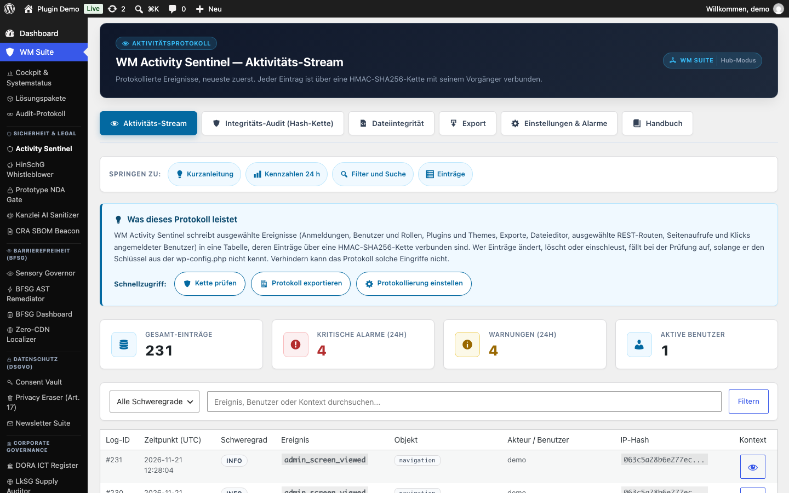
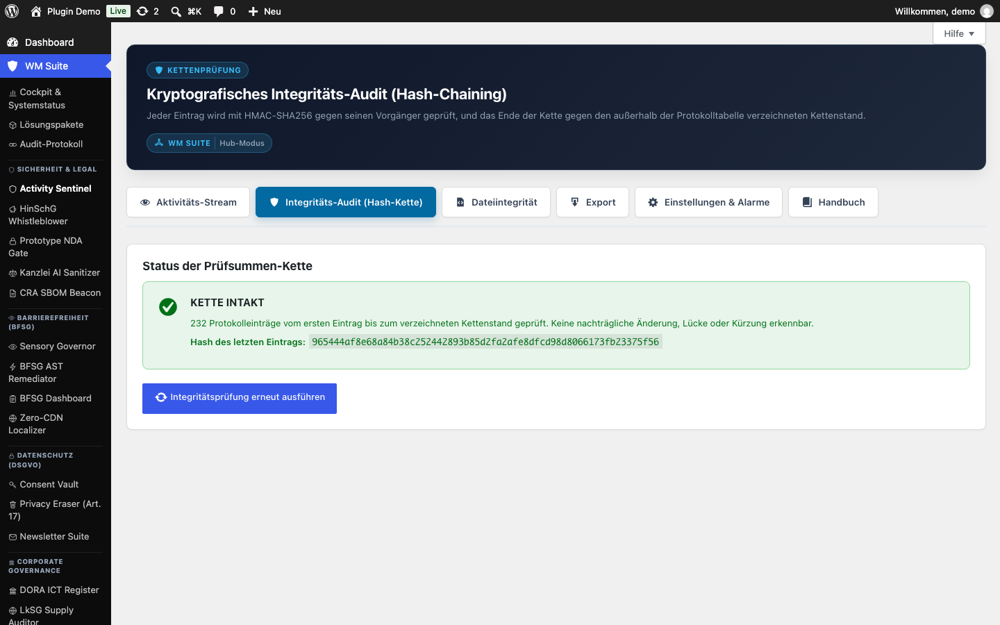
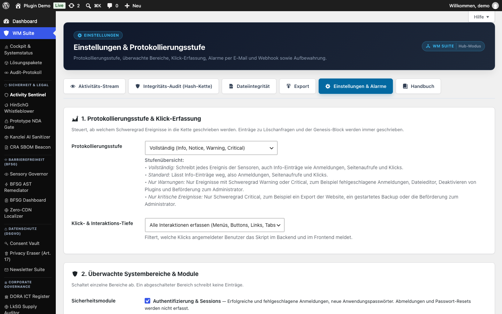
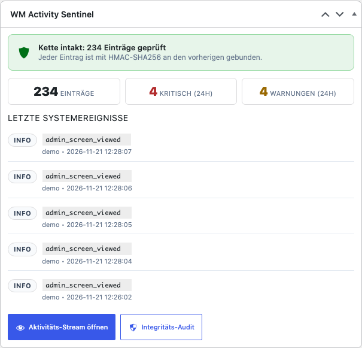

# WM Activity Sentinel (Documentación en Español)

<p align="center">
  <a href="README.md"></a>
  <a href="README.de.md"></a>
  <a href="README.es.md"></a>
</p>

> **Un registro de actividad para WordPress cuyas entradas se enlazan con una cadena HMAC-SHA256: inicios de sesión, usuarios y roles, plugins y temas, exportaciones y editor de archivos, rutas REST seleccionadas, vistas de páginas y clics de usuarios con sesión, con verificación de la cadena, alertas por correo y webhook y exportación CSV o JSON — hace detectables las ediciones, borrados y recortes posteriores para quien no tiene la clave de wp-config.php, no los impide y no hace ninguna valoración jurídica**  
> **Página del Plugin:** [https://arnoldwender.com/es/plugins-wordpress/wm-activity-sentinel/](https://arnoldwender.com/es/plugins-wordpress/wm-activity-sentinel/)  
> **Desarrollado con un agentic workflow:** creado con agentes de programación de IA. Revísalo y pruébalo como cualquier código de terceros antes de usarlo en producción.  
> **Soporte y responsabilidad:** Cero soporte (Zero Support) — errores reproducibles únicamente en [GitHub Issues](https://github.com/arnoldwender/wm-wp-activity-sentinel/issues) · sin soporte privado · TAL CUAL («AS IS») / sin responsabilidad ([SUPPORT.md](SUPPORT.md))

> Este archivo describe lo que el plugin entrega de verdad (v1.4.3; medido: WP-CLI ofrece `wp sentinel audit|list|fim|demodaten|retention`, REST ofrece `POST /telemetry` bajo `wm-sentinel/v1`, las tablas son `wp_wm_activity_logs` y `wp_wm_activity_alerts`, y la extensibilidad expone `wm_sentinel_ready`, `wm_sentinel_monitored_options`, `wm_sentinel_public_metrics`, `wm_activity_sentinel_log_event`, `wm_sentinel_security_incident`, la fuente de Block Bindings `wm-sentinel/metrics` y la etiqueta dinámica de GenerateBlocks `wm_sentinel_metric`; no hay shortcode ni exportación PDF). Versiones anteriores al 2026-09-15 describían shortcodes no implementados, subcomandos CLI y rutas REST inexistentes, nombres antiguos de tablas, informes PDF y valoraciones jurídicas no verificadas sobre GoBD, GeschGehG § 2, DSGVO art. 32 y la CRA que no existen en este repositorio. Las correcciones históricas están en [CHANGELOG.md](CHANGELOG.md).

---

## Capturas de pantalla

!Banner de WM Activity Sentinel

| Captura | Descripción |
| --- | --- |
|  | Flujo de actividad: eventos registrados, del más reciente al más antiguo, cada uno enlazado al anterior por una cadena HMAC-SHA256 |
|  | Auditoría de integridad: la cadena de hashes verificada desde la primera entrada hasta el estado de la cadena registrado |
|  | Ajustes: nivel de registro, profundidad de clics y áreas supervisadas |
|  | Widget del escritorio: estado de la cadena, contadores de las últimas 24 horas y las entradas más recientes |

---

## Qué hace el plugin

1. **Entradas del registro:** Cada entrada en `wp_wm_activity_logs` guarda el id, el nombre visible y el correo del usuario que actúa (o «System»), el tipo de evento, tipo e id del objeto, la severidad (`info`, `notice`, `warning`, `critical`), un contexto JSON, un HMAC de la IP del cliente con la fecha y `NONCE_SALT` como clave (los hashes de una misma dirección solo coinciden dentro de un día UTC), la hora UTC, el hash de la entrada anterior y su propio hash. Una entrada génesis inicia la cadena al activar el plugin.
2. **Cadena:** `entry_hash = HMAC-SHA256( prev_hash + "|" + JSON ordenado de context, created_at, event_type, ip_hmac, object_id, object_type, prev_hash, severity, user_email, user_id, user_name )` con `AUTH_KEY` como clave (o la sal guardada de WordPress cuando `AUTH_KEY` no está definida; la verificación lo señala, igual que un `AUTH_KEY` que sigue siendo el marcador de `wp-config-sample.php`). Al escribir se bloquea la fila más reciente con `SELECT … FOR UPDATE` dentro de una transacción, y el hash más reciente con el número de filas se refleja en la opción `wm_sentinel_chain_tip` antes del commit. Si falla la consulta de bloqueo o el commit, no se escribe nada ni se envía alerta.
3. **Verificación:** La página de integridad, `wp sentinel audit`, el widget del escritorio y el adaptador del hub recalculan cada hash desde la entrada génesis y comparan el final con el extremo reflejado. Reportan la primera fila cuyo enlace o hash no coincide, una tabla vaciada y una cadena más corta que el extremo reflejado. Las filas seudonimizadas por el borrado (punto 11) solo se aceptan mientras su huella coincida con el registro de borrado encadenado.
4. **Sensores:** `wp_login` y `wp_login_failed` (usuario intentado y user agent), `wp_create_application_password` (solo el nombre de la aplicación), `user_register`, `deleted_user`, `set_user_role` (critical cuando el nuevo rol es administrador), `activated_plugin`, `deactivated_plugin`, `delete_plugin`, `upgrader_process_complete`, `after_switch_theme` (tema nuevo y anterior), `updated_option` para nueve opciones (`siteurl`, `home`, `users_can_register`, `default_role`, `active_plugins`, `admin_email`, dos opciones del NDA gate, la dirección de alertas) con valor escalar anterior y nuevo, `export_wp`, visitas a `export.php`, abrir el editor de archivos de plugins o temas y cada petición de guardado desde él, `updraft_backup_started` y `duplicator_backup_started`, llamadas REST a `/wp/v2/plugins` y llamadas a `/wp/v2/users` sin sesión, cada pantalla del panel que abre un usuario con sesión y cada página del frontend que abre un usuario con sesión (dirección y referrer).
5. **Telemetría de clics:** Para usuarios con sesión, `assets/js/sentinel-tracker.js` reporta clics en enlaces, botones, menús y pestañas (etiqueta, destino, ruta CSS, dirección de la página) por lotes a `POST /wp-json/wm-sentinel/v1/telemetry`. La ruta solo acepta usuarios con sesión, solo los nueve tipos de evento conocidos (el script produce ocho; `ui_click` es el valor por defecto de una entrada sin tipo), cuatro categorías y las claves de metadatos del script, los guarda con severidad `info` y acepta como máximo 60 entradas por usuario por minuto.
6. **Ajustes:** Menú *WM Sentinel* (posición 27, con el número de entradas críticas de las últimas 24 horas), página *Einstellungen*: nivel de registro (`all`, `standard`, `strict`, `critical_only`), filtro de clics, interruptores para autenticación, usuarios, plugins y temas (incluido el editor de archivos), exportaciones y copias de seguridad, REST, pantallas del panel, clics y vistas del frontend, dirección de alertas, severidad mínima de alerta, URL de webhook, días de conservación (aplicados cada noche desde el 2026-09-17: las entradas más allá del plazo pierden nombre, dirección de correo e identificador de IP; no se borra nada) y el widget del escritorio. Las entradas génesis, de borrado y de conservación ignoran el nivel y los interruptores; los informes de integridad solo los interruptores, así que todo nivel salvo `all` descarta la entrada `info` de un escaneo diario limpio.
7. **Alertas:** Cada nueva entrada `warning` o `critical` a partir de la severidad mínima (por defecto `critical`; las entradas `notice` nunca alertan, sea cual sea el ajuste) envía un correo de texto plano a la dirección de alertas y lo anota en `wp_wm_activity_alerts`; con una URL de webhook válida sigue un POST JSON no bloqueante (`text`, `log_id`, `event_type`, `severity`, `user`, `site`, `timestamp`). Una cadena rota no dispara ninguna alerta.
8. **Stream y verificación:** *Aktivitäts-Stream* lista las entradas con filtro de severidad, búsqueda e inspector de contexto; *Integritäts-Audit* ejecuta la verificación y muestra el resultado, el hash del extremo, el número de filas seudonimizadas y un aviso cuando la clave está en la base de datos. Un widget del escritorio muestra el estado de la cadena, cifras y las últimas cinco entradas.
9. **Exportación:** *Export* ofrece un CSV UTF-8 separado por punto y coma con hasta 10.000 entradas (las celdas que empiezan con `=`, `+`, `-`, `@`, tabulador o retorno de carro llevan un apóstrofo delante) y un paquete JSON con las mismas entradas, el resultado de la verificación en el momento de exportar y una suma SHA-256 del documento sin el campo de la suma. Ninguno de los dos archivos está firmado.
10. **Datos de demostración y restablecimiento:** Se pueden añadir hasta 15 entradas marcadas `_is_demo` (aplican el nivel y los interruptores; la importación informa cuántas se escribieron y no envía correo de alerta ni webhook); quitarlas se rechaza mientras haya entradas reales (si no, se restablece todo el registro; sin entradas de demostración no pasa nada). El restablecimiento de fábrica vacía ambas tablas, inicia una cadena nueva y devuelve cada ajuste a su valor por defecto.
11. **Herramientas de privacidad de WordPress:** En *Herramientas › Exportar / Borrar datos personales* el plugin exporta hasta 1.000 entradas en las que la dirección es quien actúa o aparece en el contexto (en una sola tanda; no se paginan más). Al borrar se sustituyen el nombre, la dirección y el hash de IP de las filas de ese usuario y la dirección dentro de cualquier contexto, después de añadir una entrada encadenada `privacy_erasure_applied` con una huella con clave de cada fila cambiada; tipo de evento, hora, ids de objeto, id de usuario y el resto del contexto se quedan.
12. **WP-CLI:** `wp sentinel audit` (exit 1 con la cadena rota), `wp sentinel list [--limit] [--severity]`, `wp sentinel fim [--baseline]` (exit 1 con un archivo del núcleo alterado, un ejecutable inesperado o el sello de la línea base roto), `wp sentinel demodaten --import | --delete | --reset`, `wp sentinel retention [--dry-run]` (aplica el plazo ahora, o cuenta lo que cambiaría una pasada sin escribir nada).
13. **Spoke de WM Suite Hub:** `includes/class-sentinel-spoke-adapter.php` se registra mediante `wm_register_suite_module`: salud `ERROR` con la cadena rota, `DEGRADED` cuando la clave está en la base de datos o es el marcador de ejemplo, `HEALTHY` en otro caso; telemetría con total, entradas críticas de 24 horas, estado y error de la cadena, entradas verificadas y seudonimizadas, origen de la clave y hash del extremo; acciones `self_test` / `audit_chain` / `verify_chain`; un componente SBOM.
14. **Reenvío a un SIEM:** Apagado por defecto. Con un colector configurado, cada entrada a partir de la severidad elegida sale además como Syslog RFC 5424 (facility 13, «log audit»), ArcSight CEF:0 o IBM LEEF:2.0 por UDP, TCP o HTTPS — los formatos que leen Splunk, Microsoft Sentinel, Datadog, Elastic y QRadar. Se aplica el escape de cada formato (la barra vertical en la cabecera CEF, el signo igual en una extensión CEF, el delimitador que LEEF nombra en su propia cabecera), cada carga útil es una sola línea, y el reenvío ocurre después del COMMIT y fuera de la condición de alerta: un SIEM toma el flujo y filtra él mismo. Un colector caído no altera la entrada almacenada.
15. **Monitor de integridad de archivos:** Una comprobación diaria (encendida por defecto) compara los archivos del núcleo instalados contra el catálogo oficial de `api.wordpress.org/core/checksums/1.0/` para esta versión e idioma: archivos alterados, archivos que faltan y archivos ejecutables en `wp-admin` o `wp-includes` que el catálogo no lista — que es la forma que tiene una puerta trasera depositada. `wp-content` queda fuera porque ese directorio es del sitio, y la ausencia de `readme.html`, `license.txt` o `wp-config-sample.php` cuenta como endurecimiento y no como hallazgo. Los plugins de WM Suite no tienen catálogo oficial, así que se captura una línea base de sus archivos PHP, JS y CSS y su huella queda **sellada en la cadena HMAC**: reescribir la línea base almacenada para que cuadre con un archivo editado rompe esa entrada encadenada. Una versión que el catálogo no cubre (HTTP 200 con `"checksums": false`) se reporta como «no comprobado», nunca como limpio. El resultado se escribe como entrada propia en la cadena — y por tanto llega al SIEM cuando el reenvío está encendido.
16. **Hooks para desarrolladores, Block Bindings y GenerateBlocks Dynamic Tags:** Dispara `do_action( 'wm_sentinel_ready', $core )` tras el arranque, recibe eventos externos mediante `wm_activity_sentinel_log_event` y `wm_sentinel_security_incident`, ofrece los filtros `wm_sentinel_monitored_options` y `wm_sentinel_public_metrics`, y registra la fuente de Block Bindings `wm-sentinel/metrics` (WordPress 6.5+) y la etiqueta dinámica `wm_sentinel_metric` (GenerateBlocks 2.x) para indicadores y contadores no sensibles (`chain_status`, `verified_blocks`, `total_events`, `version`).

### No incluido

No registra cierres de sesión, restablecimientos de contraseña, cambios en entradas, páginas o medios, comentarios, WooCommerce ni inicios de sesión fallidos de otros plugins; no hay evento por cada cambio de archivo fuera del editor del panel (el monitor de integridad compara el árbol por calendario y no cubre `wp-content` más allá de los plugins de WM Suite); no borra ni archiva automáticamente (la pasada de conservación neutraliza los campos identificativos de las entradas viejas; la fila y su posición en la cadena se quedan); no hay sello de tiempo externo, exportación firmada ni PDF; no hay limitación ni agrupación de alertas; no hay shortcode ni bloque Gutenberg propio; no se valora si registrar las vistas de página y clics de usuarios con sesión, la conservación del registro o su uso como prueba está permitido.

---

## Inicio rápido

1. Instala y activa el plugin (WordPress 6.4+, PHP 8.2+, InnoDB). Asegúrate de que `AUTH_KEY` está definida en `wp-config.php`; si no, la verificación avisa de que la clave está en la base de datos.
2. Abre **WM Sentinel › Integritäts-Audit**: la entrada génesis se verifica.
3. En **Einstellungen**, elige el nivel y los interruptores, configura la dirección de alertas y decide si se registran pantallas del panel, vistas del frontend y clics de usuarios con sesión. La sección 5 configura un colector SIEM y la 6 el monitor de integridad.
4. Abre **WM Sentinel › Dateiintegrität** y captura una vez la línea base de los plugins de WM Suite, para que un cambio posterior en ellos sea detectable. Vuelve a capturarla tras cada actualización.
5. Verifica la cadena con `wp sentinel audit` y los archivos con `wp sentinel fim`, o desde el hub.
6. Fija el **plazo de conservación**. Desde el 2026-09-17 se aplica cada noche: las entradas más allá del plazo pierden nombre, dirección de correo e identificador de IP. No se borra nada — una fila borrada rompería la cadena y la verificación reportaría la propia política de conservación del sitio como manipulación. Ejecuta antes `wp sentinel retention --dry-run`. Ver [docs/SETTINGS.md](docs/SETTINGS.md#retention).

Clases, tablas, ajustes, sensores y desviaciones conocidas: **[README.md](README.md)** (referencia) y **[DEVELOPERS.md](DEVELOPERS.md)**.

```bash
php tests/test-suite.php        # cadena, extremo, nivel e interruptores, exportación y borrado de privacidad, CLI, sensores y telemetría, valores por defecto, desinstalación, adaptador, CSV, textos del panel, formatos SIEM, monitor de integridad
bash tests/run-mutations.sh     # deshace cada corrección una vez; la suite debe fallar todas las veces
# dentro de WordPress:
wp eval-file wp-content/plugins/wm-activity-sentinel/tests/test-i18n.php --allow-root
# estos escriben en el registro y solo corren con WM_SENTINEL_SCRATCH_INSTALL=1; solo en instalaciones de prueba:
WM_SENTINEL_SCRATCH_INSTALL=1 wp eval-file wp-content/plugins/wm-activity-sentinel/tests/test-sentinel-privacy-tools.php --allow-root
WM_SENTINEL_SCRATCH_INSTALL=1 wp eval-file wp-content/plugins/wm-activity-sentinel/tests/test-sentinel-sensors.php --allow-root
WM_SENTINEL_SCRATCH_INSTALL=1 wp eval-file wp-content/plugins/wm-activity-sentinel/tests/test-sentinel-chain.php --allow-root          # TRUNCATE
WM_SENTINEL_SCRATCH_INSTALL=1 wp eval-file wp-content/plugins/wm-activity-sentinel/tests/test-sentinel-tamper-evidence.php --allow-root # TRUNCATE
```

### Problemas conocidos

- Quien puede leer `wp-config.php` puede volver a firmar toda la cadena; el reflejo del extremo está en la misma base de datos; no hay sello de tiempo externo. El registro muestra intervenciones de otros, no las del operador del servidor.
- Cambiar `AUTH_KEY` hace que todas las entradas existentes fallen la verificación; lo mismo pasa al mover el sitio a un servidor con otro `wp-config.php` (medido al migrar una instalación de prueba, 2026-09-15).
- La verificación carga toda la tabla en memoria en la página de integridad, en cada carga del escritorio (widget) y en cada consulta de salud o telemetría del hub; el menú del panel cuenta entradas en cada página del panel.
- **No se borra nada, y eso es el diseño, no un hueco.** El registro es una cadena de hashes: quitar una fila rompe la comprobación de enlace en la primera superviviente y el conteo del extremo, así que la verificación reportaría la propia política de conservación del sitio como manipulación. Desde el 2026-09-17 `wm_sentinel_retention_days` (por defecto 90) *sí* se aplica, con una pasada diaria que neutraliza `user_name`, `user_email` e `ip_hmac` de las entradas viejas y deja `context` intacto, porque `context` es la prueba. **Esta línea afirmó que el ajuste «se guarda y no se aplica» hasta el 2026-09-20 — tres días después de que la pasada entrara en servicio.** Si 90 días es el plazo correcto, y si el registro sobrevive a una desinstalación, esperan a Arnold.
- El registro contiene nombres y direcciones de usuarios con sesión, cada pantalla del panel y página del frontend que abren y la etiqueta y el destino de sus clics. Si esa supervisión está permitida en un sitio no se valora; espera a Arnold.
- El borrado solo reconoce la dirección exacta; nombres de usuario, nombres visibles u otros identificadores en el contexto se quedan.
- Cada entrada que cumple el umbral envía su propio correo de alerta; no hay limitación, y un webhook fallido no se anota.
- El límite de telemetría cuenta por minuto de calendario sin bloqueo: peticiones en paralelo pueden pasar de 60, y hasta 120 entradas pueden llegar en 60 segundos al cruzar un minuto.
- Los sensores de copias de seguridad escuchan nombres de hook de UpdraftPlus y Duplicator que no se comprobaron contra esos plugins.
- **Catálogos de idiomas (`languages/`):** `wm-activity-sentinel.pot` se genera directamente del código con `wp i18n make-pot` (`tests/test-pot-freshness.php`), y los 28 pares `.po`/`.mo` están compilados, ninguno con una entrada activa vacía (medido el 2026-11-21). Las traducciones se hicieron con agentes de IA; no consta una revisión por hablantes nativos.
- Desinstalar conserva por defecto `wp_wm_activity_logs`, `wp_wm_activity_alerts`, `wm_sentinel_chain_tip` y la línea base sellada (`wm_sentinel_delete_data_on_uninstall = 0`), y solo las elimina si se activa expresamente en *Einstellungen*.

---

## Cumplimiento

- **Lo que el plugin acredita:** que los eventos listados se escribieron en este orden por código que tiene la clave, y si las filas guardadas todavía coinciden. No acredita que no pasara nada más, cuándo se escribió realmente una entrada ni quién operaba el servidor, y no decide si el registro, su conservación o su uso son lícitos.
- **Peticiones salientes:** correos de alerta mediante `wp_mail()` y, si está configurado, un POST JSON a la URL del webhook. El script de clics solo habla con la ruta REST del propio sitio.
- **Datos personales:** nombre y correo de quien actúa, hashes de IP con clave diaria, nombres de usuario de inicios de sesión fallidos, user agents, direcciones visitadas y referrers, etiquetas y destinos de clics y valores anterior y nuevo de las opciones supervisadas; se conservan hasta que se borran a mano, se borran con las herramientas de WordPress o se eliminan al desinstalar.

---

## Licencia

Distribuido bajo licencia **GNU General Public License v2 o posterior**.  
Copyright (C) 2026 Arnold Wender. Todos los derechos reservados.  
