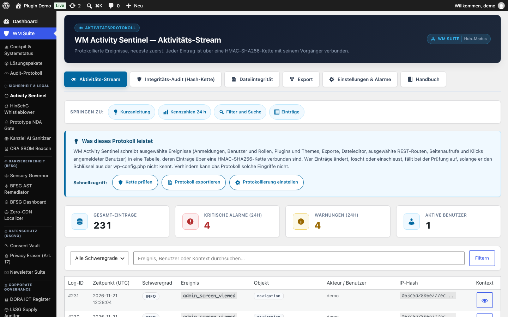
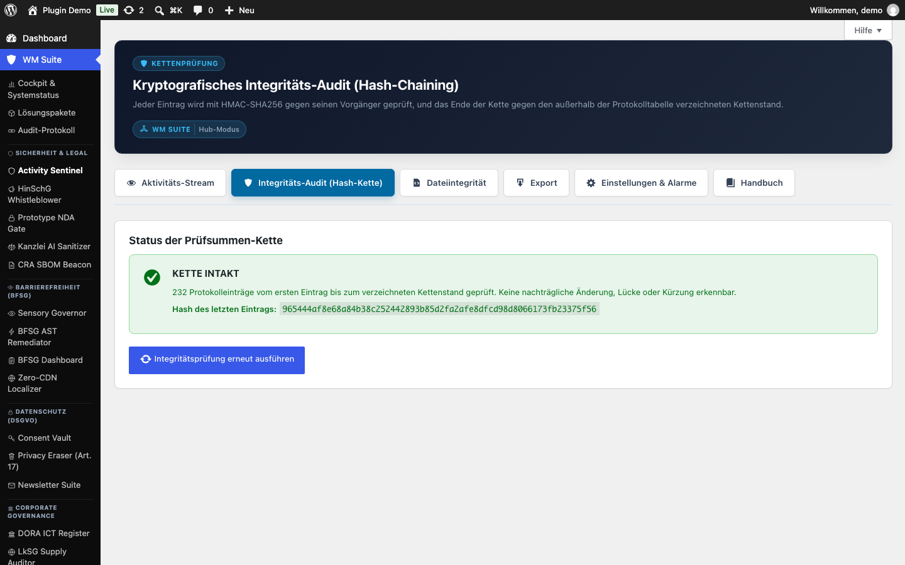
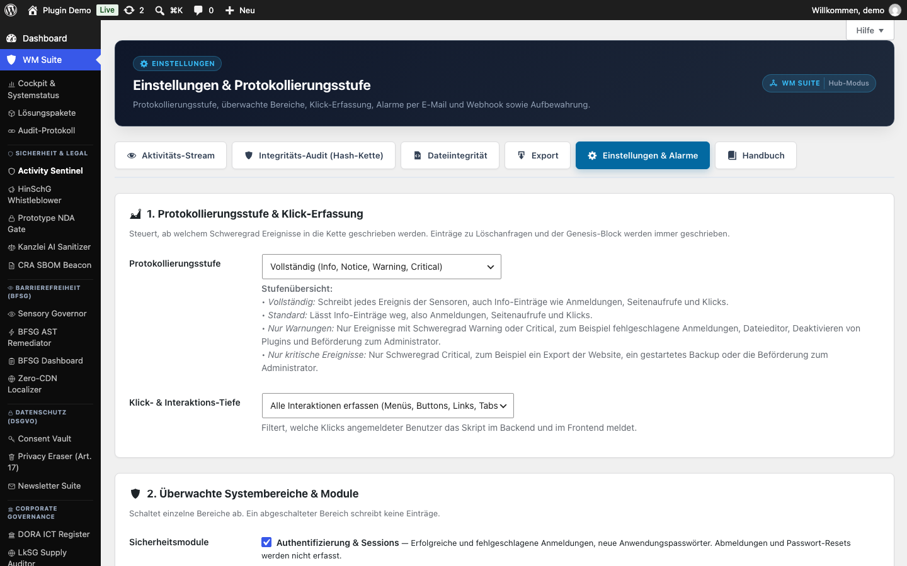
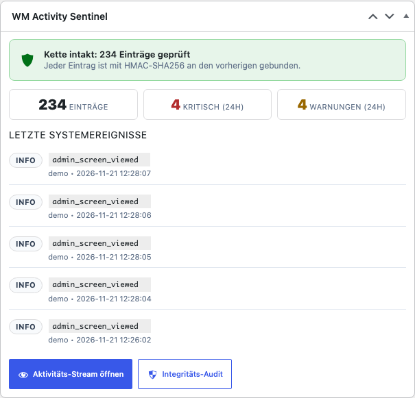

# WM Activity Sentinel

<p align="center">
  <a href="README.md"></a>
  <a href="README.de.md"></a>
  <a href="README.es.md"></a>
</p>

<p align="center">
  <a href="https://wordpress.org"></a>
  <a href="https://php.net"></a>
  <a href="LICENSE"></a>
</p>

> **An activity log for WordPress whose entries are linked by an HMAC-SHA256 chain: logins, users and roles, plugins and themes, exports and the file editor, selected REST routes, page views and clicks of signed-in users, with chain verification, a file integrity monitor against the official WordPress.org checksums, forwarding to a SIEM as Syslog RFC 5424, CEF or LEEF, mail and webhook alerts and CSV or JSON export — it makes later edits, deletions and truncation detectable for anyone without the key in wp-config.php, it does not prevent them, and it makes no legal assessment**  
> **Plugin Page:** [https://arnoldwender.com/wordpress-plugins/wm-activity-sentinel/](https://arnoldwender.com/wordpress-plugins/wm-activity-sentinel/)  
> **Built with an agentic workflow:** developed with AI coding agents. Review and test it like any third-party code before you use it in production.  
> **Support & Liability:** Zero support — reproducible bugs on [GitHub Issues](https://github.com/arnoldwender/wm-wp-activity-sentinel/issues) only · no private support · AS IS / no liability ([SUPPORT.md](SUPPORT.md))

> This README describes what the plugin ships (v1.4.3; measured: WP-CLI provides `wp sentinel audit` / `list` / `fim` / `demodaten` / `retention`, REST provides `POST /telemetry` under `wm-sentinel/v1`, the tables are `wp_wm_activity_logs` and `wp_wm_activity_alerts`, and extensibility uses `wm_sentinel_ready`, `wm_sentinel_monitored_options`, `wm_sentinel_public_metrics`, `wm_activity_sentinel_log_event`, `wm_sentinel_security_incident`, the Block Bindings source `wm-sentinel/metrics` and the GenerateBlocks Dynamic Tag `wm_sentinel_metric`; there is no shortcode and no PDF export). Earlier editions before 2026-09-15 described unshipped shortcodes, extra CLI subcommands and REST endpoints, legacy table names, PDF reports and unverified legal assessments for GoBD, GeschGehG § 2, DSGVO Art. 32 and the CRA that do not exist in this repository. Historical fixes are listed in [CHANGELOG.md](CHANGELOG.md).

---

## Screenshots

!WM Activity Sentinel banner

| Screenshot | Description |
| --- | --- |
|  | Activity stream: logged events, newest first, each linked to the previous one by an HMAC-SHA256 chain |
|  | Integrity audit: the hash chain verified from the first entry to the recorded chain state |
|  | Settings: logging level, click depth and the monitored areas |
|  | Dashboard widget: chain status, counts of the last 24 hours and the latest entries |

---

## What the plugin does

1. **Log entries.** Every entry in `wp_wm_activity_logs` stores user id, display name and e-mail of the acting user (or "System"), event type, object type and id, severity (`info`, `notice`, `warning`, `critical`), a JSON context, an HMAC of the client IP keyed with the date and `NONCE_SALT` (so hashes of one address match only within a UTC day), the UTC time, the previous entry's hash and its own hash. A genesis entry starts the chain on activation.
2. **Chain.** `entry_hash = HMAC-SHA256( prev_hash + "|" + sorted JSON of context, created_at, event_type, ip_hmac, object_id, object_type, prev_hash, severity, user_email, user_id, user_name )` with `AUTH_KEY` as key (or WordPress's stored salt when `AUTH_KEY` is not defined; both that and an `AUTH_KEY` still set to the `wp-config-sample.php` placeholder are flagged by the audit). Writing takes `SELECT … FOR UPDATE` on the newest row inside a transaction, and the newest hash and the row count are mirrored in the option `wm_sentinel_chain_tip` before the commit. When the lock query fails, or the commit does, nothing is written and no alert goes out.
3. **Verification.** The integrity page, `wp sentinel audit`, the dashboard widget and the hub adapter recompute every hash from the genesis entry on and compare the end with the mirrored tip. They report the first row whose link or hash does not match, an emptied table and a chain shorter than the tip. Rows pseudonymised by the eraser (item 11) are accepted only while their fingerprint matches the chained erasure record.
4. **Sensors.** `wp_login` and `wp_login_failed` (username attempt and user agent), `wp_create_application_password` (application name only), `user_register`, `deleted_user`, `set_user_role` (critical when the new role is administrator), `activated_plugin`, `deactivated_plugin`, `delete_plugin`, `upgrader_process_complete`, `after_switch_theme` (new and previous theme), `updated_option` for nine options (`siteurl`, `home`, `users_can_register`, `default_role`, `active_plugins`, `admin_email`, two NDA gate options, the alert address) with old and new scalar values, `export_wp`, visits to `export.php`, opening the plugin or theme file editor and every save request from it, `updraft_backup_started` and `duplicator_backup_started`, REST calls to `/wp/v2/plugins` and calls to `/wp/v2/users` without a session, every admin screen a signed-in user opens, and every frontend page a signed-in user opens (address and referrer).
5. **Click telemetry.** For signed-in users, `assets/js/sentinel-tracker.js` reports clicks on links, buttons, menus and tabs (label, target, CSS path, page address) in batches to `POST /wp-json/wm-sentinel/v1/telemetry`. The route accepts only signed-in users, only the nine event types it knows (the script produces eight; `ui_click` is the default for an entry without a type) and four categories and the script's metadata keys, stores them with severity `info`, and takes at most 60 entries per user per minute.
6. **Settings.** Menu *WM Sentinel* (position 27, with the number of critical entries of the last 24 hours), page *Einstellungen*: logging level (`all`, `standard`, `strict`, `critical_only`), click filter, switches for authentication, users, plugins and themes (including the file editor), exports and backups, REST, admin screens, clicks and frontend views, alert address, minimum alert severity, webhook URL, retention days (applied nightly since 2026-09-17: entries past the window lose name, e-mail address and IP identifier; nothing is deleted), the dashboard widget, the SIEM collector (format, transport, host and port or URL, minimum severity) and the file integrity monitor. Genesis, erasure and retention records bypass the level and the switches; integrity reports bypass only the switches, so every level but `all` drops the `info` entry of a clean daily scan.
7. **Alerts.** Each new `warning` or `critical` entry at or above the minimum severity (default `critical`; `notice` entries never alert, whatever the setting) sends a plain-text mail to the alert address and records it in `wp_wm_activity_alerts`; with a valid webhook URL, a non-blocking JSON POST (`text`, `log_id`, `event_type`, `severity`, `user`, `site`, `timestamp`) follows. A broken chain does not raise an alert.
8. **Stream and audit.** *Aktivitäts-Stream* lists entries with severity filter, search and a context inspector; *Integritäts-Audit* runs the verification and shows the result, the tip hash, the number of pseudonymised rows and a warning when the key lives in the database. A dashboard widget shows chain status, counts and the last five entries.
9. **Export.** *Export* offers a semicolon-separated UTF-8 CSV of up to 10,000 entries (cells starting with `=`, `+`, `-`, `@`, tab or carriage return get a leading apostrophe) and a JSON package with the same entries, the verification result at export time and a SHA-256 checksum of the document without the checksum key. Neither file is signed.
10. **Demo data and reset.** Up to 15 entries marked `_is_demo` can be appended (the logging level and switches apply; the import reports how many were written and sends no alert mail or webhook); removing them is refused while real entries exist (the whole log is reset otherwise; with no demo entries nothing happens). The factory reset empties both tables, starts a new chain and restores every setting to its default.
11. **WordPress privacy tools.** Under *Tools › Export / Erase Personal Data* the plugin exports up to 1,000 entries where the address is the actor or appears in the context (in one batch; more are not paged). Erasing replaces name, address and IP hash of the actor rows and the address inside any context, after appending a chained `privacy_erasure_applied` entry with a keyed fingerprint of each changed row; event type, time, object ids, user id and the rest of the context stay.
12. **WP-CLI.** `wp sentinel audit` (exit 1 on a broken chain), `wp sentinel list [--limit] [--severity]`, `wp sentinel fim [--baseline]` (exit 1 on a modified core file, an unexpected executable or a broken baseline seal), `wp sentinel demodaten --import | --delete | --reset`, `wp sentinel retention [--dry-run]` (applies the configured window now, or counts what a pass would change and writes nothing).
13. **WM Suite Hub spoke.** `includes/class-sentinel-spoke-adapter.php` registers through `wm_register_suite_module`: health `ERROR` with a broken chain, `DEGRADED` when the key lives in the database or is the sample placeholder, `HEALTHY` otherwise; telemetry with totals, critical entries of 24 hours, chain status and error, verified and pseudonymised entries, key source and tip hash; actions `self_test` / `audit_chain` / `verify_chain`; one SBOM component.
14. **SIEM forwarding.** Off by default. With a collector configured, every entry at or above the chosen severity is also sent as Syslog RFC 5424 (facility 13, "log audit"), ArcSight CEF:0 or IBM LEEF:2.0 over UDP, TCP or HTTPS — the formats Splunk, Microsoft Sentinel, Datadog, Elastic and QRadar read. Each format's escaping is applied (the pipe in a CEF header, the equals sign in a CEF extension, the delimiter LEEF names in its own header), every payload is a single line, and the forwarder runs after the commit and outside the alert condition, so the SIEM receives the stream and filters it itself. A collector that is down returns false and is not retried; the stored entry is unaffected.
15. **File integrity monitor.** A daily scan (on by default) compares the installed core files against the official catalogue at `api.wordpress.org/core/checksums/1.0/` for this version and locale: modified files, missing files, and executable files sitting in `wp-admin` or `wp-includes` that the catalogue does not list — which is what a dropped backdoor looks like. `wp-content` is skipped, since the site owns it, and the absence of `readme.html`, `license.txt` or `wp-config-sample.php` counts as hardening rather than a finding. The WM Suite plugins have no official catalogue, so a baseline of their PHP, JS and CSS files is captured and its fingerprint **sealed into the hash chain**: rewriting the stored baseline to match an edited file breaks that chained entry. A version the API does not know (answered with HTTP 200 and `"checksums": false`) is reported as "not checked", never as clean. The result is written into the chain as its own entry — and therefore forwarded to the SIEM when forwarding is on.
16. **Developer hooks, Block Bindings and GenerateBlocks Dynamic Tags.** Fires `do_action( 'wm_sentinel_ready', $core )` after core boot, bridges external events via `wm_activity_sentinel_log_event` and `wm_sentinel_security_incident`, filters monitored options and public metrics via `wm_sentinel_monitored_options` and `wm_sentinel_public_metrics`, and registers the WordPress 6.5+ Block Bindings source `wm-sentinel/metrics` and the GenerateBlocks 2.x Dynamic Tag `wm_sentinel_metric` for non-sensitive status and counters (`chain_status`, `verified_blocks`, `total_events`, `version`).

### Not shipped

No logging of logouts, password resets, post, page or media changes, comments, WooCommerce or login failures of other plugins; no per-change event for files outside the admin editor (the integrity monitor compares the tree on a schedule instead, and does not cover `wp-content` beyond the WM Suite plugins); no automatic deletion or archiving (the retention pass neutralises the identifying fields of old entries; the rows and their chain positions stay); no external timestamp and no signed export or PDF; no rate limit or grouping for alerts; no shortcode or standalone Gutenberg block; no assessment of whether logging signed-in users' page views and clicks, the retention of the log or its use as evidence is permitted.

---

## Quick start

1. Install and activate the plugin (WordPress 6.4+, PHP 8.2+, InnoDB). Make sure `AUTH_KEY` is defined in `wp-config.php`; otherwise the audit warns that the key is in the database.
2. Open **WM Sentinel › Integritäts-Audit**: the genesis entry verifies.
3. Under **Einstellungen**, choose the logging level and switches, set the alert address and decide whether admin screens, frontend views and clicks of signed-in users should be logged. Section 5 configures a SIEM collector, section 6 the file integrity monitor.
4. Open **WM Sentinel › Dateiintegrität** and capture the baseline of the WM Suite plugins once, so a later change to them is detectable. Re-capture it after every plugin update.
5. Check the chain regularly with `wp sentinel audit` and the files with `wp sentinel fim`, or through the hub.
6. Set **Aufbewahrungsfrist**. Since 2026-09-17 it is applied nightly: entries past the window lose name, e-mail address and IP identifier. Nothing is deleted — a deleted row would break the chain and the audit would report your own retention policy as tampering. Run it now with `wp sentinel retention --dry-run` first. See [docs/SETTINGS.md](docs/SETTINGS.md#retention).

---

## Settings

All 25 options, with their defaults, accepted values and what each one actually changes:
**[docs/SETTINGS.md](docs/SETTINGS.md)**. The canonical list is
`WM_Sentinel_Database::default_options()`; `tests/test-suite.php` fails if an option exists
there and is not documented.

`wm_sentinel_retention_days` is the one that acts on its own: a daily event neutralises the
identifying fields of entries past the window. Below 30 days means keep everything.

Three others — `wm_sentinel_monitor_screens`, `wm_sentinel_monitor_frontend_views` and
`wm_sentinel_monitor_ui_interactions` — record the browsing behaviour of identified people and
default to on. Whether that is permissible on a given site is an open question (§ 87 Abs. 1
Nr. 6 BetrVG as well as DSGVO); the plugin takes no position.

---

## Developers

Classes, tables, settings, sensors and the hub adapter: **[DEVELOPERS.md](DEVELOPERS.md)**.
Every setting: **[docs/SETTINGS.md](docs/SETTINGS.md)**.

```bash
php tests/test-suite.php        # chain, tip, level and switches, privacy exporter and eraser, CLI, sensors and telemetry, defaults, uninstall, adapter, CSV, admin text, SIEM formats, file integrity monitor
php tests/test-pot-freshness.php # every string the code translates has an entry in the .pot (needs wp-cli)
bash tests/run-mutations.sh     # undoes each fix once; the suite must fail every time
# inside WordPress:
wp eval-file wp-content/plugins/wm-activity-sentinel/tests/test-i18n.php --allow-root
# these write to the log and refuse to run without WM_SENTINEL_SCRATCH_INSTALL=1; scratch installs only:
WM_SENTINEL_SCRATCH_INSTALL=1 wp eval-file wp-content/plugins/wm-activity-sentinel/tests/test-sentinel-privacy-tools.php --allow-root   # temporary users, erasure records stay in the chain
WM_SENTINEL_SCRATCH_INSTALL=1 wp eval-file wp-content/plugins/wm-activity-sentinel/tests/test-sentinel-sensors.php --allow-root        # appends test entries
WM_SENTINEL_SCRATCH_INSTALL=1 wp eval-file wp-content/plugins/wm-activity-sentinel/tests/test-sentinel-chain.php --allow-root          # TRUNCATE
WM_SENTINEL_SCRATCH_INSTALL=1 wp eval-file wp-content/plugins/wm-activity-sentinel/tests/test-sentinel-tamper-evidence.php --allow-root # TRUNCATE
```

### Known issues

- Whoever can read `wp-config.php` can re-sign the whole chain; the tip mirror lives in the same database; there is no external timestamp. The log shows edits by others, not by the server's operator.
- Changing `AUTH_KEY` makes every existing entry fail verification; so does moving the site to a server with another `wp-config.php` (measured on a migrated staging site, 2026-09-15).
- Verification reads the whole table into memory on the integrity page, on every dashboard load (widget) and on every hub health or telemetry call; the admin menu counts entries on every admin page.
- **Nothing is deleted, and that is the design, not a gap.** The log is a hash chain: removing a row breaks the linkage check at the first survivor and the tip count at the end, so the audit would report the site's own retention policy as tampering. Since 2026-09-17 `wm_sentinel_retention_days` (default 90) *is* applied, by a daily pass that neutralises `user_name`, `user_email` and `ip_hmac` of older entries and leaves `context` alone, because `context` is the evidence. **This line claimed the setting was "stored and not applied" until 2026-09-20 — three days after the pass shipped**, and so did the 24 translated READMEs, which are generated from this file. Whether 90 days is the right window, and whether the log survives uninstall, wait for Arnold.
- The log holds names and addresses of signed-in users, every admin screen and frontend page they open and the labels and targets of their clicks. Whether that monitoring is permitted on a given site is not assessed; it waits for Arnold.
- The eraser matches the exact address string; usernames, display names or other identifiers in context stay.
- Each qualifying entry sends its own alert mail; there is no throttle, and a failed webhook is not recorded.
- The telemetry limit counts per calendar minute without a lock: parallel requests can pass 60, and up to 120 entries can land within 60 seconds across a minute boundary.
- The backup sensors listen to hook names for UpdraftPlus and Duplicator that were not checked against those plugins.
- The integrity monitor hashes roughly 3,000 core files per run (measured against the 6.8.2 catalogue: 3,230 entries, 273 KB of JSON, of which 432 are under `wp-content` and skipped). That belongs in the daily cron; the admin page shows the stored report instead of scanning on every load.
- It depends on `api.wordpress.org` being reachable and on the installed version having a published catalogue. Neither is a finding, and neither is an all-clear: both are reported as "not checked".
- The catalogue is chosen by the *installed package* (`$wp_local_package`), not by the site's display language. A site running a localized package that was later overwritten with English files, or the reverse, will differ from the catalogue it is compared against — correctly, since the files really do differ.
- A modified theme, a modified third-party plugin and anything else under `wp-content` outside the WM Suite plugins are not covered.
- The baseline covers the PHP, JS and CSS of the `wm-*` plugins including their `vendor/` directories, but not `node_modules`, `.git` or the other development directories, which never belong in a deployed plugin. Above 20,000 files it is refused rather than stored.
- The baseline proves only that the plugin files still match the moment it was captured. Whoever can write to `wp_options` and to the log table can re-seal it, exactly as with the chain tip.
- The daily scan writes one entry per run. On a clean install that is one `info` entry a day, which every logging level but `all` drops.
- **Language catalogs (`languages/`):** `wm-activity-sentinel.pot` is extracted directly from the codebase with `wp i18n make-pot` (verified by `tests/test-pot-freshness.php`), and all 28 `.po`/`.mo` locale pairs are compiled, none with an empty active entry (measured 2026-11-21). The translations were produced with AI coding agents; no review by native speakers is on record.
- Uninstalling preserves `wp_wm_activity_logs`, `wp_wm_activity_alerts`, `wm_sentinel_chain_tip` and the sealed FIM baseline by default (`wm_sentinel_delete_data_on_uninstall = 0`), removing them only when explicitly enabled under *Einstellungen*.

---

## Translated documentation

Translated READMEs live in `docs/translations/README.<lang>.md`. Their headings are translated; the sections on what the plugin does, the quick start, what is not included and compliance are English and synchronised from this file.

| Language (Native) | Locale Code | Language (Native) | Locale Code |
|---|---|---|---|
| [Български](docs/translations/README.bg.md) | `bg_BG` | [Magyar](docs/translations/README.hu.md) | `hu_HU` |
| [Čeština](docs/translations/README.cs.md) | `cs_CZ` | [Italiano](docs/translations/README.it.md) | `it_IT` |
| [Dansk](docs/translations/README.da.md) | `da_DK` | [Lietuvių](docs/translations/README.lt.md) | `lt_LT` |
| [Deutsch](README.de.md) | `de_DE` | [Latviešu](docs/translations/README.lv.md) | `lv_LV` |
| [Ελληνικά](docs/translations/README.el.md) | `el_GR` | [Malti](docs/translations/README.mt.md) | `mt_MT` |
| [English](README.md) | `en_GB` | [Nederlands](docs/translations/README.nl.md) | `nl_NL` |
| [Español](README.es.md) | `es_ES` | [Polski](docs/translations/README.pl.md) | `pl_PL` |
| [Eesti](docs/translations/README.et.md) | `et_EE` | [Português](docs/translations/README.pt.md) | `pt_PT` |
| [Suomi](docs/translations/README.fi.md) | `fi_FI` | [Română](docs/translations/README.ro.md) | `ro_RO` |
| [Français](docs/translations/README.fr.md) | `fr_FR` | [Slovenčina](docs/translations/README.sk.md) | `sk_SK` |
| [Gaeilge](docs/translations/README.ga.md) | `ga_IE` | [Slovenščina](docs/translations/README.sl.md) | `sl_SI` |
| [Hrvatski](docs/translations/README.hr.md) | `hr_HR` | [Svenska](docs/translations/README.sv.md) | `sv_SE` |

---

## Compliance

- **What the plugin establishes:** that the listed events were written in this order by code holding the key, and whether the stored rows still match. It does not establish that nothing else happened, when an entry was really written, or who operated the server, and it does not decide whether the logging, its retention or its use are lawful.
- **Outbound requests:** alert mails through `wp_mail()`; when configured, a JSON POST to the webhook URL and the forwarded entries to the SIEM collector; and, while the integrity monitor is on, one daily GET to `api.wordpress.org/core/checksums/1.0/` carrying the WordPress version and the site locale and nothing else — the same two values WordPress already sends on every update check. The click tracker talks only to the site's own REST route.
- **Personal data:** actor name and e-mail, daily-keyed IP hashes, usernames of failed logins, user agents, visited addresses and referrers, click labels and targets, and old and new values of the monitored options, kept until deleted by hand, erased through the WordPress tools or dropped on uninstall.

---

## Contribution & Security

- [CONTRIBUTING.md](CONTRIBUTING.md) · [SECURITY.md](SECURITY.md) · [CHANGELOG.md](CHANGELOG.md)

---

## License

Distributed under the **GNU General Public License v2 or later**.  
Copyright (C) 2026 Arnold Wender.  
