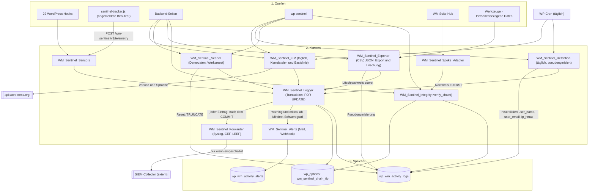

# System- und Sicherheitsarchitektur — WM Activity Sentinel

> **Aktivitätsprotokoll mit HMAC-SHA256-Kette, Kettenprüfung und Sensoren**  
> Gemessen am Code dieses Repositorys (2026-09-15). Die vorige Fassung nannte „25+ forensische Sensoren“, einen „Blockchain Verifier“, eine Alarm-Drosselung, die Klassen `WM_Sentinel_Privacy` und `WM_Sentinel_Demodaten` und eine irreversible, GoBD-konforme Löschung; nichts davon existiert in dieser Form. Referenz für Entwickler: [DEVELOPERS.md](../DEVELOPERS.md).

---

## 1. Die Kette

Jeder Eintrag verweist über `prev_hash` auf den Hash seines Vorgängers; der erste Eintrag (Genesis) trägt `prev_hash = GENESIS`. Das Kettenende wird zusätzlich außerhalb der Log-Tabelle in der Option `wm_sentinel_chain_tip` verzeichnet, damit auch das Abschneiden der jüngsten Einträge auffällt.

```
┌──────────────────────────┐     ┌──────────────────────────┐     ┌──────────────────────────┐
│ #1 genesis_initialized   │     │ #2                       │     │ #3                       │
│ prev_hash:  GENESIS      │◄────┤ prev_hash:  entry_hash#1 │◄────┤ prev_hash:  entry_hash#2 │
│ entry_hash: HMAC(…)      │     │ entry_hash: HMAC(…)      │     │ entry_hash: HMAC(…)      │
└──────────────────────────┘     └──────────────────────────┘     └──────────────────────────┘
                                                                   wm_sentinel_chain_tip = { hash: entry_hash#3, count: 3 }
```

### Formel für Eintrag $n$

$$\text{entry\_hash}_n = \text{HMAC-SHA256}\left(\text{prev\_hash}_{n-1} \,\|\, \texttt{"|"} \,\|\, \text{json}(\text{Felder}),\ K\right)$$

* **Felder** (alphabetisch sortiert): `context`, `created_at`, `event_type`, `ip_hmac`, `object_id`, `object_type`, `prev_hash`, `severity`, `user_email`, `user_id`, `user_name`. `context` ist selbst ein JSON-Text mit rekursiv sortierten Schlüsseln.
* **$K$** = `AUTH_KEY` aus der `wp-config.php`; ist `AUTH_KEY` nicht definiert, `wp_salt( 'auth' )`, also ein in der Datenbank gespeicherter Wert. Die Prüfung meldet, welcher Fall vorliegt.
* **Schreiben:** Transaktion, `SELECT … ORDER BY log_id DESC LIMIT 1 FOR UPDATE`, Hash berechnen, `INSERT`, Kettenende in `wm_sentinel_chain_tip` schreiben, `COMMIT`. Das Kettenende wird seit dem 2026-09-15 vor dem `COMMIT` geschrieben, solange die Sperre gilt.

### Prüfung

`WM_Sentinel_Integrity::verify_chain()` liest alle Zeilen, prüft Verweis und Hash jeder Zeile ab Genesis und vergleicht das Ende mit `wm_sentinel_chain_tip`. Pseudonymisierte Zeilen werden anerkannt, solange ein später geschriebener Nachweis ihren geschlüsselten Fingerabdruck enthält und dieser noch passt — aus der Löschfunktion (`privacy_erasure_applied`) **oder aus dem täglichen Aufbewahrungs-Durchlauf (`retention_pseudonymized`)**. Ohne den zweiten Fall würde die Prüfung die eigene Aufbewahrungsregel der Website als Manipulation melden.

---

## 2. Datenbank (InnoDB)

### Tabelle `wp_wm_activity_logs`

* `log_id` BIGINT UNSIGNED AUTO_INCREMENT (Primärschlüssel)
* `user_id` BIGINT UNSIGNED NULL — handelnder Benutzer, NULL für System und Besucher
* `user_name` VARCHAR(100), Standard `System` · `user_email` VARCHAR(100)
* `event_type` VARCHAR(100) · `object_type` VARCHAR(50) · `object_id` BIGINT UNSIGNED NULL
* `severity` ENUM(`info`, `notice`, `warning`, `critical`)
* `context` LONGTEXT — JSON
* `ip_hmac` VARCHAR(64) — HMAC-SHA256 der Client-IP mit Datum und `NONCE_SALT` als Schlüssel
* `created_at` DATETIME (UTC) · `prev_hash` VARCHAR(64) · `entry_hash` VARCHAR(64)
* `tsa_timestamp` TEXT NULL — ungenutzt, nichts schreibt oder liest die Spalte
* Indizes: `(user_id, created_at)`, `severity`, `event_type`, `created_at`

### Tabelle `wp_wm_activity_alerts`

* `alert_id` (Primärschlüssel) · `log_id` · `severity` ENUM(`warning`, `critical`)
* `alert_message` TEXT (Betreff der Mail) · `channel` VARCHAR(50) · `status` ENUM(`sent`, `failed`, `pending`) · `created_at`
* Vermerkt werden nur Mail-Alarme; der Webhook wird nicht vermerkt.

---

## 3. Sensoren

`WM_Sentinel_Sensors::init_sensors()` registriert 24 Hooks, die Telemetrie-Route und das Klick-Skript:

| Bereich | Hooks | Ereignisarten |
| --- | --- | --- |
| Exporte, Backups, Dateieditor | `export_wp`, `admin_init` (nur `export.php`), `load-plugin-editor.php`, `load-theme-editor.php`, `wp_ajax_edit-theme-plugin-file`, `updraft_backup_started`, `duplicator_backup_started` | `export_wp_native_triggered`, `export_page_inspected`, `plugin_theme_file_viewed`, `plugin_theme_file_save_requested`, `database_backup_requested` |
| Plugins, Themes, Optionen | `activated_plugin`, `deactivated_plugin`, `delete_plugin`, `upgrader_process_complete`, `after_switch_theme`, `updated_option` (neun Optionen, erweiterbar über `wm_sentinel_monitored_options`) | `plugin_activated`, `plugin_deactivated`, `plugin_deleted`, `upgrader_process_executed`, `theme_switched`, `core_options_updated` |
| Anmeldung und Benutzer | `wp_login_failed`, `wp_login`, `user_register`, `deleted_user`, `set_user_role`, `wp_create_application_password` | `user_login_failed`, `user_login_success`, `user_created`, `user_deleted`, `user_role_changed` (Critical bei Administrator), `application_password_created` |
| REST | `rest_pre_dispatch` | `rest_plugins_enumerated`, `rest_users_enumerated` (ohne Sitzung) |
| Navigation | `current_screen`, `template_redirect` | `admin_screen_viewed`, `frontend_page_viewed` (nur angemeldete Benutzer) |
| Klicks | `rest_api_init`, `wp_enqueue_scripts` (im Backend über `admin_enqueue_scripts`) | neun bekannte Klick-Ereignisarten (das Skript erzeugt acht), Schweregrad `info`, höchstens 60 pro Benutzer und Kalenderminute (ohne Sperre) |
| Inter-Plugin-Brücken | `wm_activity_sentinel_log_event`, `wm_sentinel_security_incident` | `hub_audit_bridged` (WM Suite Hub & Spokes), `security_incident_reported` (z. B. RequestShield; Roh-IP wird nie im Kontext gespeichert, nur als Tages-HMAC) |

Nicht erfasst: Abmeldungen, Passwort-Resets, Änderungen an Beiträgen, Seiten, Medien und Kommentaren, das Löschen von Themes (Installationen erfasst `upgrader_process_complete` als `upgrader_process_executed`), Dateiänderungen außerhalb des Backend-Editors.

---

## 4. Komponenten



Die beiden gestrichelten Ziele sind die einzigen ausgehenden Wege neben Alarm-Mail und Webhook;
der Collector bekommt personenbezogene Daten, `api.wordpress.org` nicht (siehe
[DSGVO-COMPLIANCE.md](DSGVO-COMPLIANCE.md), Abschnitt 5).

---

## 5. Sprachen und personenbezogene Daten

* **Sprachkataloge:** 28 `.po`/`.mo`-Paare in `languages/` (`ar`, `bg_BG`, `cs_CZ`, `da_DK`, `de_DE`, `el`, `en_GB`, `en_US`, `es_ES`, `et`, `fi`, `fi_FI`, `fr_FR`, `ga`, `hr_HR`, `hu_HU`, `it_IT`, `lt_LT`, `lv`, `mt_MT`, `nl_NL`, `pl_PL`, `pt_PT`, `ro_RO`, `sk_SK`, `sl_SI`, `sv_SE`, `tr_TR`). `wm-activity-sentinel.pot` wird per `wp i18n make-pot` direkt aus dem Code erzeugt (`tests/test-pot-freshness.php`), und alle 28 Kataloge sind vollständig übersetzt und frei von doppelter Kodierung; die Quelltexte sind Deutsch.
* **Löschanfragen:** Die Löschfunktion ersetzt Name, Adresse und IP-Hash der Einträge des Benutzers sowie die Adresse im Kontext durch Platzhalter, nachdem ein verketteter Löschnachweis mit einem Fingerabdruck jeder geänderten Zeile geschrieben wurde. Ereignisart, Zeit, Objekt-IDs, Benutzer-ID und der übrige Kontext bleiben stehen. Ob das einer Löschanfrage genügt, bewertet das Plugin nicht. Details: [DSGVO-COMPLIANCE.md](DSGVO-COMPLIANCE.md).

---

<!-- wm-measured-inventory -->

## Measured inventory

Regenerated from the code, never hand-edited. Everything above this line is written by hand and stays.

```bash
python3 the fleet's architecture inventory tool wm-activity-sentinel --append-to docs/ARCHITECTURE.md
```

## Inventory by layer

**16 PHP files, 6708 lines** (excluding `tests/`, `vendor/`, `node_modules/`, `languages/`).

| Layer | Files | Lines |
|---|---:|---:|
| `(raíz)` | 2 | 272 |
| `includes` | 14 | 6436 |

---

## Classes

| Class | File |
|---|---|
| `WM_Sentinel_Admin` | [`includes/class-sentinel-admin.php`](../includes/class-sentinel-admin.php) |
| `WM_Sentinel_Alerts` | [`includes/class-sentinel-alerts.php`](../includes/class-sentinel-alerts.php) |
| `WM_Sentinel_CLI_Command` | [`includes/class-sentinel-cli.php`](../includes/class-sentinel-cli.php) |
| `WM_Sentinel_Core` | [`includes/class-sentinel-core.php`](../includes/class-sentinel-core.php) |
| `WM_Sentinel_Database` | [`includes/class-sentinel-database.php`](../includes/class-sentinel-database.php) |
| `WM_Sentinel_Exporter` | [`includes/class-sentinel-exporter.php`](../includes/class-sentinel-exporter.php) |
| `WM_Sentinel_FIM` | [`includes/class-sentinel-fim.php`](../includes/class-sentinel-fim.php) |
| `WM_Sentinel_Forwarder` | [`includes/class-sentinel-forwarder.php`](../includes/class-sentinel-forwarder.php) |
| `WM_Sentinel_Integrity` | [`includes/class-sentinel-integrity.php`](../includes/class-sentinel-integrity.php) |
| `WM_Sentinel_Logger` | [`includes/class-sentinel-logger.php`](../includes/class-sentinel-logger.php) |
| `WM_Sentinel_Retention` | [`includes/class-sentinel-retention.php`](../includes/class-sentinel-retention.php) |
| `WM_Sentinel_Seeder` | [`includes/class-sentinel-seeder.php`](../includes/class-sentinel-seeder.php) |
| `WM_Sentinel_Sensors` | [`includes/class-sentinel-sensors.php`](../includes/class-sentinel-sensors.php) |
| `WM_Sentinel_Spoke_Adapter` | [`includes/class-sentinel-spoke-adapter.php`](../includes/class-sentinel-spoke-adapter.php) |

---

## Entry points

**REST routes:** `/telemetry`

**WP-CLI:** `sentinel`

**AJAX actions:** `edit-theme-plugin-file`

---

## Persistence — who writes each key and who reads it

| Key | Written by | Read by |
|---|---|---|
| `wm_sentinel_alert_email` | `includes/class-sentinel-admin.php` | `includes/class-sentinel-admin.php`, `includes/class-sentinel-alerts.php` |
| `wm_sentinel_alert_min_severity` | `includes/class-sentinel-admin.php` | `includes/class-sentinel-admin.php`, `includes/class-sentinel-alerts.php` |
| `wm_sentinel_delete_data_on_uninstall` | `includes/class-sentinel-admin.php` | `includes/class-sentinel-admin.php`, `uninstall.php` |
| `wm_sentinel_enable_dashboard_widget` | `includes/class-sentinel-admin.php` | `includes/class-sentinel-admin.php` |
| `wm_sentinel_fim_enabled` | `includes/class-sentinel-admin.php` | `includes/class-sentinel-admin.php`, `includes/class-sentinel-fim.php` |
| `wm_sentinel_fim_scan_suite` | `includes/class-sentinel-admin.php` | `includes/class-sentinel-admin.php`, `includes/class-sentinel-fim.php` |
| `wm_sentinel_log_auth` | `includes/class-sentinel-admin.php` | `includes/class-sentinel-admin.php`, `includes/class-sentinel-logger.php` |
| `wm_sentinel_log_content` | `includes/class-sentinel-admin.php` | `includes/class-sentinel-admin.php`, `includes/class-sentinel-logger.php` |
| `wm_sentinel_log_plugins` | `includes/class-sentinel-admin.php` | `includes/class-sentinel-admin.php`, `includes/class-sentinel-logger.php` |
| `wm_sentinel_log_rest` | `includes/class-sentinel-admin.php` | `includes/class-sentinel-admin.php`, `includes/class-sentinel-logger.php` |
| `wm_sentinel_log_users` | `includes/class-sentinel-admin.php` | `includes/class-sentinel-admin.php`, `includes/class-sentinel-logger.php` |
| `wm_sentinel_logging_intensity` | `includes/class-sentinel-admin.php` | `includes/class-sentinel-admin.php`, `includes/class-sentinel-logger.php` |
| `wm_sentinel_monitor_frontend_views` | `includes/class-sentinel-admin.php` | `includes/class-sentinel-admin.php`, `includes/class-sentinel-logger.php`, `includes/class-sentinel-sensors.php` |
| `wm_sentinel_monitor_screens` | `includes/class-sentinel-admin.php` | `includes/class-sentinel-admin.php`, `includes/class-sentinel-logger.php`, `includes/class-sentinel-sensors.php` |
| `wm_sentinel_monitor_ui_interactions` | `includes/class-sentinel-admin.php` | `includes/class-sentinel-admin.php`, `includes/class-sentinel-logger.php`, `includes/class-sentinel-sensors.php` |
| `wm_sentinel_retention_days` | `includes/class-sentinel-admin.php` | `includes/class-sentinel-admin.php`, `includes/class-sentinel-retention.php` |
| `wm_sentinel_siem_enabled` | `includes/class-sentinel-admin.php` | `includes/class-sentinel-admin.php`, `includes/class-sentinel-forwarder.php` |
| `wm_sentinel_siem_format` | `includes/class-sentinel-admin.php` | `includes/class-sentinel-admin.php`, `includes/class-sentinel-forwarder.php` |
| `wm_sentinel_siem_host` | `includes/class-sentinel-admin.php` | `includes/class-sentinel-admin.php`, `includes/class-sentinel-forwarder.php` |
| `wm_sentinel_siem_min_severity` | `includes/class-sentinel-admin.php` | `includes/class-sentinel-admin.php`, `includes/class-sentinel-forwarder.php` |
| `wm_sentinel_siem_port` | `includes/class-sentinel-admin.php` | `includes/class-sentinel-admin.php`, `includes/class-sentinel-forwarder.php` |
| `wm_sentinel_siem_transport` | `includes/class-sentinel-admin.php` | `includes/class-sentinel-admin.php`, `includes/class-sentinel-forwarder.php` |
| `wm_sentinel_siem_url` | `includes/class-sentinel-admin.php` | `includes/class-sentinel-admin.php`, `includes/class-sentinel-forwarder.php` |
| `wm_sentinel_telemetry_intensity` | `includes/class-sentinel-admin.php` | `includes/class-sentinel-admin.php`, `includes/class-sentinel-sensors.php` |
| `wm_sentinel_webhook_url` | `includes/class-sentinel-admin.php` | `includes/class-sentinel-admin.php`, `includes/class-sentinel-alerts.php` |

Every key has exactly one writing layer and at least one reader.


**Tables** (prefixed with `$wpdb->prefix`): `wm_activity_alerts`, `wm_activity_logs`

---

## Gates

- `tests/run-mutations.sh`
- `tests/test-i18n.php`
- `tests/test-pot-freshness.php`
- `tests/test-sentinel-chain.php`
- `tests/test-sentinel-privacy-tools.php`
- `tests/test-sentinel-sensors.php`
- `tests/test-sentinel-tamper-evidence.php`
- `tests/test-suite.php`
- `tests/test-ui-family.php`
- `.github/workflows/ci.yml`

What CI actually runs is in the workflow files above — a test file that no workflow invokes is not a gate.

---

## Drift detected against the documentation

Nothing measurable: versions agree and every class named in the documents exists.

